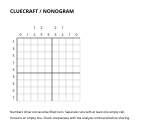

# Cluecraft

**Draw a small picture. Build a puzzle. Check that the clues tell one story.**

Cluecraft turns `#`/`.` pixel art into nonogram clues and printable SVG puzzles.
It also checks whether a clue set has no solution, one solution, or multiple
solutions, using a bounded conventional constraint search.

This is a new command-line project for puzzle makers. It uses Python 3.11+ with
no runtime dependencies, accounts, telemetry, AI models, or network services.



## Quick start

```bash
git clone https://github.com/sameerdeolalikar/cluecraft.git
cd cluecraft
python3 -m cluecraft build examples/beacon.txt -o beacon.json
python3 -m cluecraft analyze beacon.json
python3 -m cluecraft render examples/beacon.txt -o puzzle.svg
python3 -m cluecraft render examples/beacon.txt --solution -o answer.svg
```

Open the SVGs in a browser or SVG editor. The puzzle output leaves cells blank;
the answer key shows the original artwork. Output uses 7 mm cells on one custom
sheet. Larger puzzles may exceed standard paper sizes; automatic page fitting
and PDF export are not implemented. Physical printing has not yet been tested.

To install the `cluecraft` command, use `python -m pip install .` inside a Python
virtual environment. This installs this checkout, not a published PyPI release.

## Draw your own design

Create a rectangular text file using only `#` for filled cells and `.` for empty
cells. Spaces and tabs, including at the edges, are invalid. Leading and trailing
line endings (LF, CRLF, or CR) are ignored. Other control characters and Unicode
line separators are invalid. Designs can have 1–25 rows and columns. For example:

```text
..#..
..#..
#####
..#..
..#..
```

Nonogram clues describe consecutive filled runs, separated by at least one empty
cell. Empty lines use `[]` in JSON and display `0` in the printable puzzle.
An attractive drawing does not automatically produce a uniquely solvable puzzle.

## Interpret analysis correctly

The `analyze` command prints JSON with `status`, `solutions_found`, `nodes`, and
`first_solution`. It checks clue JSON, not the original image.

| Status | Meaning |
| --- | --- |
| `unique` | The search finished and found exactly one solution |
| `multiple` | At least two solutions were found; search stops after two |
| `unsatisfiable` | Search finished and found none |
| `unknown` | A search or line-pattern limit was reached; uniqueness is not established |

```bash
python3 -m cluecraft analyze beacon.json --max-nodes 200000
```

The default budget is 100,000 attempted row assignments, not a time limit. Each
line has a separate 10,000-pattern cap. This solver is intended for small puzzles;
it does not estimate human difficulty or provide logical explanations yet.
`solutions_found` is a lower bound when analysis stops early.

Invalid documents fail with exit code 2. A completed analysis command returns 0
for every status, including `unknown`: automation must inspect the JSON status.
Existing output files are protected unless `--force` is specified.

## Clue documents

```json
{"version": 1, "rows": [[1], [1]], "columns": [[1], [1]]}
```

This two-by-two example has two solutions. The versioned format contains only
clue lists, not names, accounts, or personal information. Inputs are limited to
100 KB. Invalid clue lengths, values, and inconsistent filled-cell totals are
rejected before solving. Duplicate JSON field names are also rejected rather
than silently using the last value.

## Development

```bash
python3 -m unittest discover -s tests -v
```

The suite includes exhaustive cross-checks against all
2 × 3 binary grids and all binary lines up to length 7. It checks uniqueness,
ambiguity, impossible puzzles, budget exhaustion, and answer-key separation.
Tests ran on Python 3.14; GitHub Actions and other-version verification are pending.

`puzzle.py` handles clues and solving, `svg.py` handles printable output, and
`cli.py` handles commands. See [ROADMAP.md](ROADMAP.md) and
[CONTRIBUTING.md](CONTRIBUTING.md). Licensed under [MIT](LICENSE).
